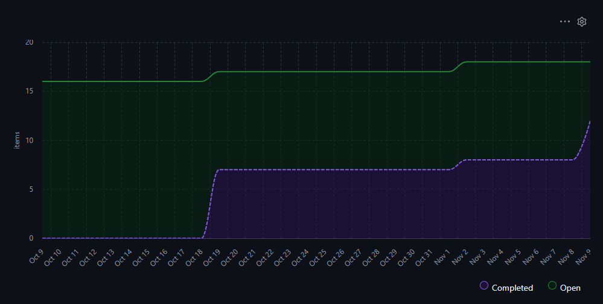

# Sprint 2 Metrics & EVM Report

## Project Overview

The Student Training project is planned across three sprints. By the end of Sprint 2, we completed 11 of the 16 active development issues, totaling 51 out of 76 planned story points. The virtual interviewing expansion was deferred through our CCB decision and is not included in the active project scope.

## Velocity Analysis

| Sprint | Completed Issues | Story Points |
|---|---:|---:|
| Sprint 1 | 7 | 25 |
| Sprint 2 | 4 | 26 |

Our velocity increased from 25 to 26 story points, which is a 4% improvement. This shows that we maintained a steady pace across both sprints and completed slightly more estimated work during Sprint 2.

## Burn-Up Performance

The burn-up chart shows an increase in completed issues throughout the project. It tracks the number of issues rather than their story points. By the end of Sprint 2, all 11 scheduled development issues were marked Done. The chart also includes a completed retrospective issue.

## Earned Value Management (EVM)

Our active project baseline is 76 story points. Since the project consists of three sprints, the assignment requires us to use two-thirds of the total planned work as PV and two-thirds of the overall budget as the assumed AC.

| Metric | Calculation | Result |
|---|---|---:|
| Planned Value (PV) | 76 x 2/3 | 50.67 |
| Earned Value (EV) | 25 + 26 | 51.00 |
| Actual Cost (AC) | 76 x 2/3 | 50.67 |
| Schedule Performance Index (SPI) | 51 / 50.67 | 1.01 |
| Cost Performance Index (CPI) | 51 / 50.67 | 1.01 |
| Estimate at Completion (EAC) | 76 / CPI | 75.50 |
| Estimate to Complete (ETC) | EAC - AC | 24.83 |

These calculations use story-point-equivalent values based on the assignment's assumptions rather than actual financial expenses.

Our SPI and CPI are both slightly above 1.00. This suggests that we are slightly ahead of schedule and performing a little better than the assumed budget baseline. Based on our current performance, we estimate that another 24.83 equivalent units will be needed to finish the project.

## Sprint 3 Outlook

Sprint 3 has five remaining issues totaling 25 story points. Our goal is to finish these features while keeping our progress consistent. We will also continue monitoring our schedule and make sure the deferred virtual interviewing expansion stays outside the current project scope.
